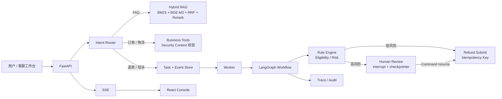

# Customer Service & Ticket Copilot

面向电商 / SaaS 售后场景的企业智能客服与工单 Agent：把**知识问答**、**实时业务查询**和**有副作用的退款/投诉流程**拆成三条路径，而不是把所有请求都塞进一个 LLM Agent Loop。

> 状态：教学版基线重构中。`main` 当前为可运行的教学版，目标架构见 [Roadmap](#roadmap) 与 `docs/adr/`。

## 为什么不是普通 AI 客服 Demo

真正难的不是聊天框，而是：

- 订单、物流、退款状态是实时事实，不能进向量库
- 退款能否执行是确定性规则，不能由模型决定
- 退款有副作用，必须幂等
- 高风险退款需要人工审核，且能跨进程恢复
- 任务生命周期不能依赖浏览器连接
- 出问题时要能回放是哪一层错了

## 架构



## 核心设计

| 决策 | 原因 |
|---|---|
| 订单/物流直连 Tool | 确定性实时事实，更快、更便宜、更稳定 |
| 退款/投诉进 Workflow | 多步骤、有分支、可能有人工审核和副作用 |
| 模型只做理解与解释 | 资格、金额、优先级必须确定性、可审计 |
| `refund:{tenant_id}:{order_id}` + UNIQUE | 防止重试、重复 Resume 造成重复退款 |
| Task 落库 + Worker 独立执行 | 浏览器断开不中止后台任务 |
| LangGraph `interrupt` + checkpointer | 人工审核暂停点可持久化、可恢复 |

详细决策见 `docs/adr/`，术语见 [GLOSSARY.md](GLOSSARY.md)。

## Demo Cases

| Case | 输入 | 预期 |
|---|---|---|
| 物流异常 | `O10001` 运输中 38 小时未更新 | 直连 Tool，自动创建 P2 `logistics_abnormal` 工单 |
| 低风险退款 | `O10002` 399 元未发货 | Rule Engine 判定可退，自动提交退款 |
| 高额退款 | `O10003` 12999 元 VIP 未发货 | 进入两级人工审核，Resume 后提交退款 |
| 重复退款 | `O10004` 已有退款记录 | 返回 `DUPLICATE_REFUND_REQUEST`，不再创建 |
| VIP 投诉 | `O10005` VIP 强投诉 | P1 工单，指派 `complaint_specialist` |
| FAQ | 电子发票怎么开 | 走 RAG，返回当前有效版本 |

## Quickstart

### 本地（Mock）

```bash
cd backend
python -m venv .venv
# Windows: .venv\Scripts\activate
# macOS/Linux: source .venv/bin/activate
pip install -r requirements.txt

python -m app.scripts_seed
uvicorn app.main:app --reload --port 8000

# 另开终端：后台 Worker
python -m app.worker
```

```bash
cd frontend
npm install
npm run dev
```

打开 `http://localhost:5173`，在 Agent Lab 选择 Mock Case 运行。

### Docker Compose

```bash
docker compose up --build
```

前端 `http://localhost:3000`，API `http://localhost:8000`。

## 目录

```
backend/
  app/
    api/          # HTTP 接口、SSE
    core/         # 配置、Security Context
    db/           # 数据库与 schema
    rag/          # 混合检索与精排
    services/     # Router、规则、Tool、Task
    workflow/     # LangGraph 编排
    eval/         # Golden Dataset 评测
    worker.py     # 后台任务消费
frontend/
  src/pages/      # Dashboard、Agent Lab、Ticket、Refund、Review、Trace...
docs/
  adr/            # 架构决策
  agents/         # 协作流程
mock_data/        # 演示输入
```

## 评测

目标是用 Golden Dataset 做端到端评测，而不是只看最终话术：

- Intent 路由
- Retrieval：Active Version、BM25、Embedding、Rerank
- Tool Selection 与参数
- 权限与租户边界
- Eligibility / Risk
- Ticket Route / Priority / SLA
- Human Review 顺序与恢复

## Roadmap

- [x] 阶段 0：README、GLOSSARY、ADR、基线提交
- [ ] 阶段 1：SQLAlchemy、SiliconFlow Provider、真 BM25 / Embedding / Rerank、SSE / 日志
- [ ] 阶段 2：LangGraph 节点重构、interrupt + checkpointer、原子幂等
- [ ] 阶段 3：只读 Agent Loop + 预算终止
- [ ] 阶段 4：Golden Dataset 端到端评测、Bad Case 闭环
- [ ] 阶段 5：前端 3 个重点页面
- [ ] 阶段 6：测试补齐
- [ ] 阶段 7：公网 Demo 与 CI（暂缓）

## 已知限制

- 教学版单租户、单 Worker，未做 RBAC 与多副本调度
- SQLite 为默认存储；Postgres 通过 `DATABASE_URL` 切换
- 公网部署暂缓，Docker Compose 保持可直接部署

## License

MIT
